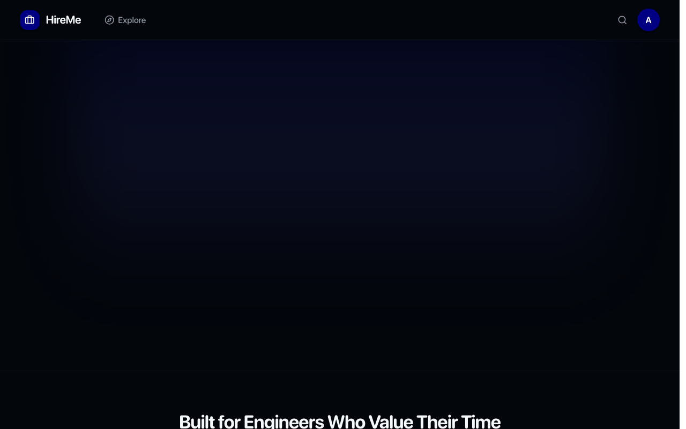

# 🍿 Orbit : The Private Cinema & Autonomous Media Ecosystem

<div align="center">


**A private, Netflix-grade personal cinema and automated media streaming system that downloads the highest quality releases automatically, sanitizes every incoming file, and streams anywhere with zero buffering—all running 100% self-contained on external storage.**

<br/>



<p><em>Orbit Mission Control: Real-time service monitoring, storage telemetry, download bandwidth, and one-click VPN switching.</em></p>

</div>

---

## 🌟 Why Orbit?

Standard streaming services are fragmented, expensive, compress audio into low-bitrate streams, and rotate catalogs constantly. Standard home media setups, on the other hand, require constant manual torrent searching, suffer from audio transcode buffering on mobile devices, burn through SSD write endurance, and leave open network ports exposed to your local Wi-Fi.

**Orbit solves all of this.** It is engineered as an autonomous, self-healing personal cinema appliance:

* 🎬 **Pristine Cinema Fidelity**: Direct-Play 4K UHD Remuxes with uncompressed Dolby Atmos, TrueHD 7.1, and DTS-HD MA surround sound.
* ⚡ **1-Click Request & Autonomous Retrieval**: Tap request on any movie or TV series—Orbit searches indexers, selects the cleanest high-bitrate release, downloads it behind an encrypted VPN, sanitizes it, and adds it to your library in minutes.
* 🚀 **Zero-Buffering Playback Anywhere**: Stream securely to your phone, tablet, laptop, or Apple TV/Android TV across town or across the globe over a private encrypted WireGuard mesh—with **zero open router ports**.
* 🔋 **Zero Host Wear & Auto-Sleep**: When no downloads are active, Orbit's ingestion engines enter deep sleep after 15 minutes, parking external hard drive heads and freeing 100% of CPU and RAM for your machine.
* ✈️ **Offline Travel Ready**: When you are on a plane or traveling without internet, the entire server functions seamlessly over localhost loopback without requiring an internet connection.

---

## 🎬 The Ultimate Personal Cinema Experience

### 1. Dynamic 16:9 Trailer Hero Banners
When you open a movie or series details page, Orbit automatically resolves the official trailer (preferring zero-transcode local high-definition assets or 1080p stream fallbacks) and plays an authentic **16:9 theatrical video banner** directly above the synopsis.
* Includes a frosted glass speaker toggle with smooth volume ramping.
* An intelligent scroll sensor automatically pauses trailer playback when scrolling down to cast lists, conserving system resources.

### 2. Instant Card Hover Video Previews
Browsing through horizontal library rails feels alive. Hovering your cursor over any film poster portal activates a singleton video preview overlay.
* **Kinetic Intent Detection**: Moving your cursor faster than `0.8 px/ms` cancels preview spawning, so rapid skimming and scrolling stays butter-smooth without accidental popups.
* **5-Tier Fallback Cascade**: Automatically cascades from local high-bitrate trailers to official remote trailers, trickplay sprite scrubbing, and subtle cinematic pan-and-scan animations.

### 3. "Surprise Me" Roulette & In-App Discovery
Can't decide what to watch tonight? 
* Tap the **🎲 Surprise Me** button in the top navigation or slide-out drawer.
* Orbit surfaces critically acclaimed, high-rated titles (filtered strictly for IMDb/TMDb rating ≥ 7.0 with 100+ reviews).
* Preview the synopsis, cast, and trailer—and if it's not yet in your library, tap **"Request to Watch"** to initiate autonomous ingestion immediately without ever leaving the player.

### 4. Direct-Play 4K HDR & Spatial Audio
* Direct-stream pass-through for 4K UHD, HDR10, and Dolby Vision color profiles.
* Multi-channel passthrough for TrueHD, Dolby Atmos, and DTS-HD Master Audio on compatible home theater systems.

---

## ⚡ Autonomous "MAX Quality" Ingestion Engine

```
[ Discover / Request ] ──▶ [ Best-Swarm Hunter ] ──▶ [ Isolated VPN Ingestion ] ──▶ [ Zero-Trust Gatekeeper ] ──▶ [ Instant Library Ready ]
  (Jellyfin / Seerr)          (4K UHD Remux / 1080p)        (Encrypted WireGuard tun0)      (Audio Remux & ClamAV)          (Sub-1ms Atomic Move)
```

### 1. Automated Best-Release Hunter
Orbit eliminates manual torrent searches. When a title is requested:
* It queries verified indexers and evaluates releases against custom quality profiles: **MAX (4K UHD Remux)**, **High (1080p BluRay)**, and **Medium (720p/1080p WEB-DL)**.
* Evaluates seed health, release groups, and audio codecs to grab the cleanest, fastest release available.

### 2. ⚡ "Turbo Mode" Instant Download Queue
When you want to watch something immediately rather than wait for background downloads:
* Tap **⚡ Turbo** on any request inside the Mission Control dashboard.
* Orbit pauses all competing background downloads and allocates **100% of your WAN bandwidth** exclusively to your selected movie.
* **Triple-Redundant Auto-Resume**: Monitored by a continuous reconciler loop, completion webhooks, and status reconcilers to ensure paused downloads auto-resume the exact second the priority film finishes.

### 3. Zero-Trust Autonomous File Gatekeeper
Every incoming file passes through an automated 4-stage sanitization gate before entering your cinema library:
1. **Container Magic Byte Verification**: Validates real media container headers (`video/*`, `application/x-matroska`), immediately purging disguised scripts or executables.
2. **Execution Bit Stripping**: Cleans permissions to `chmod 644`, guaranteeing files cannot execute code on the host.
3. **Audio Normalization & Subtitle Decoupling**: Video is stream-copied with zero re-encoding. If no stereo AAC track exists, the gatekeeper synthesizes a crisp AAC Stereo track on Audio Track 0 for instant playback on phones and tablets, while preserving master lossless surround audio on Audio Track 1. Text subtitles are decoupled into clean `.srt` sidecars.
4. **Antivirus Scanning**: Streams each file to a dedicated ClamAV daemon. Clean files are atomically moved into your library using the POSIX `rename()` syscall (<1ms execution time).

### 4. Smart Drive & Battery Preservation
Unlike 24/7 seedboxes that keep your hard drive spinning and laptop fans humming:
* The entire ingestion sandbox runs **strictly on demand**.
* Once active downloads finish and the queue is clear, Orbit enters a 15-minute cooldown.
* If no new requests arrive, the download containers stop completely, allowing external drive heads to safely park and returning 100% of CPU and RAM back to your laptop.

---

## 🌐 Ultra-Low Latency Streaming Anywhere

| Feature | How Orbit Delivers It |
| :--- | :--- |
| **Encrypted Mesh Access** | Connect securely over **Tailscale WireGuard**. Stream from your phone, laptop, or Android TV anywhere in the world with zero port forwarding and zero open ports on your Wi-Fi router. |
| **Silicon-Tuned Hardware Transcoding** | Zero-copy VAAPI hardware acceleration optimized for AMD Radeon graphics. Transcodes video in GPU VRAM with under 8% CPU utilization across all cores. |
| **Tier 0 RAM Transcode Buffer** | Real-time video streaming chunks are written directly to a 2.5 GB in-memory RAM scratchpad (`tmpfs`). Enjoy instantaneous seeking with **zero flash SSD wear**. |
| **Indian Broadband DPI Bypass** | Circumvents aggressive ISP Deep Packet Inspection on metadata services via an internal encrypted proxy tunnel with ~4ms latency. |
| **Offline Airplane Mode** | When traveling without internet, the entire server is accessible locally over `http://127.0.0.1:8096`. |

---

## 🎛️ Mission Control Dashboard

Accessible at `http://127.0.0.1:3000`:
* **Zero Dependencies**: Pure Node.js standard libraries—zero `node_modules` bloat.
* **Live System Telemetry**: CPU load, memory utilization, and real-time external storage disk gauges.
* **Download Fleet Status**: Active torrents, transfer rates, ETA, and priority management.
* **Hot-Swappable VPN Switcher**: Switch VPN profiles (Cloudflare WARP, ProtonVPN, Windscribe, Mullvad, AirVPN) with a single click.

---

## 🚀 Quickstart Guide

### 1. Prerequisites
Ensure your Linux system has Podman, Podman Compose, and WireGuard tools:
```bash
# Arch Linux / Manjaro
sudo pacman -S podman podman-compose wireguard-tools ffmpeg jq curl

# Enable user Podman socket
systemctl --user enable --now podman.socket
```

### 2. Configure Environment
Copy the sanitized environment template:
```bash
cp .env.example .env
chmod 600 .env
```
*Add your Tailscale configuration and any desired VPN or API credentials to `.env`.*

### 3. Launch Orbit
```bash
./start.sh
```
*Verifies storage mounts, initializes NVMe high-speed cache, starts trusted streaming services, joins your Tailscale mesh, and activates the background supervisor.*

Open **`http://localhost:3000`** to access your Mission Control cockpit, or **`http://localhost:8096`** for Jellyfin Cinema.

### Lifecycle Commands
* **Graceful Teardown**: `./stop.sh` (Safely flushes write buffers, stops containers, and releases all system resources).
* **Graceful Restart**: `./restart.sh` (or `./restart.sh --with-sandbox` to immediately wake the download pipeline).

---

## 🔒 Security & Privacy Posture

* **Rootless Podman**: Containers execute inside unprivileged user namespaces (UID 1000). Root exploits terminate in unmapped host UIDs.
* **No-New-Privileges**: Declared across all containers, blocking privilege escalation via setuid binaries.
* **Zero LAN Port Exposure**: Binds strictly to `127.0.0.1` and encrypted WireGuard mesh. Invisible to local network scans.
* **Zero Credential Leaking**: Live keys, databases, Tailscale machine keys, and personal configs are strictly isolated and ignored by Git.

For in-depth systems specifications, network namespace maps, and kernel optimization profiles, consult the [Architecture Specification](ARCHITECTURE.md).

---

## 📜 License

Architected by the **Alpha Prod Orbit Engineering Team**.  
Released under the [MIT License](LICENSE).
