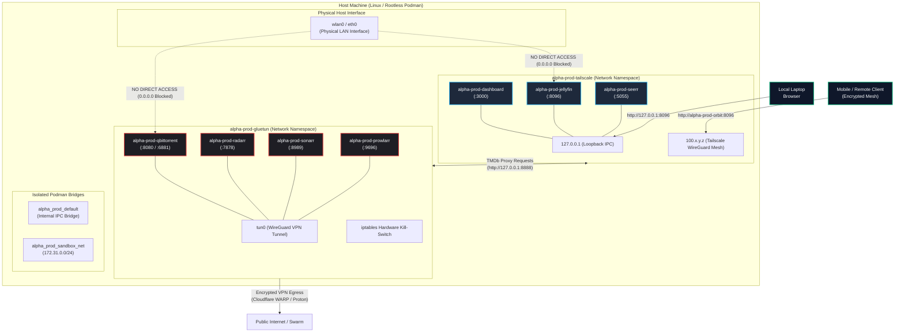
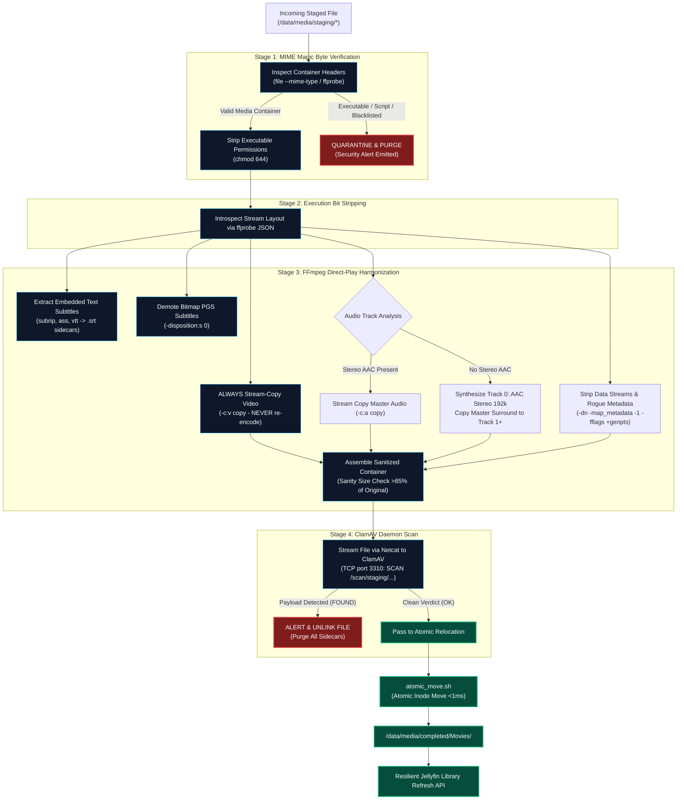

# 🍿 Alpha Prod Orbit

<div align="center">


**An ephemeral, zero-local-network-footprint, personal cinema and video streaming infrastructure running rootless Podman containers on external storage.**

[Architecture Spec](ARCHITECTURE.md) • [Service Matrix](#-master-service-matrix) • [Hardware Acceleration](#-amd-vega-8-hardware-acceleration-vcn-10) • [Installation Guide](#-installation--quickstart) • [Security Controls](#-security-controls--zero-trust-posture)

</div>

---

## 🏛️ Executive Summary & Design Tenets

`alpha-prod-orbit` is a production-grade personal cinema and private video streaming system architected for deployment directly on external storage (`/run/media/banana/Alpha`). Unlike conventional media servers that expose open ports across a local area network (LAN) and write system state to internal operating system partitions, `alpha-prod-orbit` enforces strict **ephemeral, zero-footprint, zero-trust** engineering principles:

```
┌──────────────────────────────────────────────────────────────────────────────────────────────────┐
│                                   CORE ARCHITECTURAL TENETS                                      │
├──────────────────────────────┬───────────────────────────────────────────────────────────────────┤
│ Zero Local Footprint         │ Container ports bind strictly to 127.0.0.1 or route over Tailscale│
│                              │ WireGuard. Zero ports are exposed on 0.0.0.0 or physical LAN NICs.│
├──────────────────────────────┼───────────────────────────────────────────────────────────────────┤
│ Ephemeral Container Lifecycle│ The stack materializes on demand via ./start.sh and completely    │
│                              │ dissolves via ./stop.sh, returning 100% CPU and RAM to the host.  │
├──────────────────────────────┼───────────────────────────────────────────────────────────────────┤
│ Externalized Persistence     │ All media, configurations, databases, caches, and cryptographic   │
│                              │ keys reside exclusively on external Alpha media (/run/media/...). │
├──────────────────────────────┼───────────────────────────────────────────────────────────────────┤
│ Rootless Podman Execution    │ Daemonless, unprivileged container execution via Linux user       │
│                              │ namespaces. Root exploit attempts terminate inside unmapped uids. │
├──────────────────────────────┼───────────────────────────────────────────────────────────────────┤
│ Zero-Trust Ingestion         │ Every downloaded media asset is considered hostile until passed   │
│                              │ through a rigorous 4-stage binary and antivirus sanitization gate.│
└──────────────────────────────┴───────────────────────────────────────────────────────────────────┘
```

---

## 🌐 Network Topology & Sidecar Architecture

The network model eliminates standard container port publishing. No service container communicates directly with the physical network interface (`eth0` or `wlan0`). Network access is split into two isolated domains:

1. **The Core Stack Network Domain**: Governed by the `alpha-prod-tailscale` sidecar.
2. **The Ingestion Sandbox Network Domain**: Governed by the `alpha-prod-gluetun` VPN sidecar with an `iptables` hardware kill-switch.



### Dual-Access Network Model
* **Offline Localhost Loopback**: Services map strictly to `127.0.0.1`. When offline or traveling without Wi-Fi, the full media server functions seamlessly via `http://127.0.0.1:8096`.
* **Encrypted Tailscale Mesh**: Authorized devices (smartphones, tablets, Android TV, remote family laptops) connect through end-to-end encrypted WireGuard tunnels (`http://alpha-prod-orbit:8096`).
* **TMDb DPI Circumvention**: Multiple ISPs enforce aggressive Deep Packet Inspection (DPI) on `api.themoviedb.org`. `alpha-prod-seerr` routes all outbound TMDb queries through Gluetun's internal HTTP forward proxy (`127.0.0.1:8888`), achieving ~4ms latency over WireGuard.

---

## ⚡ AMD Vega 8 Hardware Acceleration (VCN 1.0)

Configured in `jellyfin/config/encoding.xml` specifically for AMD Ryzen mobile APUs with Video Core Next (VCN 1.0):

```
┌────────────────────────────────────────────────────────────────────────────────────────┐
│                        AMD VEGA 8 (VCN 1.0) SILICON CODEC MATRIX                       │
├──────────────────────┬─────────────┬─────────────┬─────────────────────────────────────┤
│ Codec                │ HW Decode   │ HW Encode   │ Architectural Constraint            │
├──────────────────────┼─────────────┼─────────────┼─────────────────────────────────────┤
│ H.264 (AVC)          │ YES (8-bit) │ YES (8-bit) │ Full hardware acceleration          │
│ HEVC (H.265 Main)    │ YES (8-bit) │ YES (8-bit) │ Full hardware acceleration          │
│ HEVC (H.265 Main 10) │ YES (10-bit)│ YES (10-bit)│ Full 10-bit HDR decode supported    │
│ VP9 Profile 0 (8-bit)│ YES         │ NO          │ Decode only (YouTube video format)  │
│ VP9 Profile 2(10-bit)│ YES         │ NO          │ Decode only                         │
│ VC-1                 │ YES         │ NO          │ Legacy format decode only           │
│ AV1                  │ NO          │ NO          │ Silicon limitation: VCN 1.0 lacks   │
│                      │             │             │ AV1 ASICs. Direct-Play mandated.    │
└──────────────────────┴─────────────┴─────────────┴─────────────────────────────────────┘
```

* **Zero-Copy VAAPI Pipeline**: Demuxed frames go directly to GPU VRAM (`VASurfaceID`), hardware post-processing (VPP) scales directly in memory, and the VCN encode ring generates H.264/HEVC slices with under 8% total CPU usage.
* **4-Credit Concurrency Model**: 1080p stream = 1 credit (up to 4 simultaneous streams); 4K HDR transcode with tonemapping = 4 credits (strictly 1 stream); Direct-Play = 0 credits (unlimited).
* **Tier 0 RAM `tmpfs` Transcode Scratchpad**: Transcode directory is mounted as an in-memory POSIX `tmpfs` (`/cache/transcodes:size=2560M,mode=1777`), eliminating SSD flash write wear from HLS chunks.

---

## 🛡️ Gatekeeper: 4-Stage Zero-Trust Sanitization

All incoming media arriving in `/data/media/staging` must pass all 4 gates in `sandbox/gatekeeper.sh` before entering the cinema library:



* **Sub-Millisecond Atomic Inode Relocation**: `atomic_move.sh` confirms `SRC_DEV == DST_DEV` and moves verified files across directories using the POSIX `rename()` syscall (<1ms for an 80GB Remux, zero byte copying).
* **Automated Retention Engine**: `retention.sh` queries Jellyfin's REST API for user play counts. Purges watched items older than 7 days and stale unplayed items older than 30 days along with sidecar subtitles.

---

## ✨ Web Client Dynamic UI Overrides

Injected into Jellyfin Web (`jellyfin/index.html`) to deliver an authentic cinematic streaming experience:

| Module | Location | Capabilities |
| :--- | :--- | :--- |
| **Trailer Hero Banner** | `jellyfin/custom-details-hero.js` | Dynamic 16:9 trailer embedded above media details. Zero-transcode local trailer fallback, YouTube 1080p interceptor, glassmorphic floating audio button, and `IntersectionObserver` scroll auto-pause. |
| **Card Hover Preview** | `jellyfin/custom-hover-preview.js` | Singleton floating portal overlay with kinetic intent filtering (>0.8 px/ms cancels intent; requires 2000ms dwell) and 5-tier fallback cascade (Local trailer ➜ YouTube ➜ TMDb ➜ Trickplay BIF ➜ Poster Zoom). |
| **Discover & Request** | `jellyfin/custom-discover-request.js` | Injects "🎲 Surprise Me" in header and "✨ Discover & Request" in sidebar. Generates filtered high-rated candidates (Rating ≥ 7.0, Votes ≥ 100) with 1-click background dispatch to Seerr. |

---

## 🗄️ 4-Tier Memory & Storage Hierarchy

```
┌─────────────────────────────────────────────────────────────────────────────────────────────────┐
│                               4-TIER STORAGE & MEMORY HIERARCHY                                 │
├──────┬──────────────────────┬─────────────┬──────────────┬──────────────────────────────────────┤
│ Tier │ Storage Medium       │ Mount Path  │ Capacity     │ Data Assets & Access Pattern         │
├──────┼──────────────────────┼─────────────┼──────────────┼──────────────────────────────────────┤
│ T0   │ Host RAM (tmpfs)     │ /cache/     │ 2.5 GiB      │ Real-time HLS video transcode chunks.│
│      │                      │ transcodes  │              │ Ultra-high IOPS, zero flash wear.    │
├──────┼──────────────────────┼─────────────┼──────────────┼──────────────────────────────────────┤
│ T1   │ Host NVMe SSD        │ /var/tmp/   │ ~50 GiB      │ Btrfs NoCoW (+C) partition. Houses   │
│      │                      │ jellyfin-   │              │ trickplay BIF thumbnails, subtitle   │
│      │                      │ cache       │              │ extraction cache, image poster cache.│
├──────┼──────────────────────┼─────────────┼──────────────┼──────────────────────────────────────┤
│ T2   │ Kernel VFS Cache     │ Host Memory │ Dynamic      │ Linux page cache. Buffers SQLite     │
│      │                      │ Subsystem   │              │ database pages and active streams.   │
├──────┼──────────────────────┼─────────────┼──────────────┼──────────────────────────────────────┤
│ T3   │ External HDD (Alpha) │ /media/     │ Multi-TB     │ Persistent media library, Radarr /   │
│      │                      │ Alpha       │              │ Sonarr DBs, Tailscale identities.    │
└──────┴──────────────────────┴─────────────┴──────────────┴──────────────────────────────────────┘
```

---

## 🕹️ Mission Control Dashboard

Accessible at `http://127.0.0.1:3000`:

* **Zero External Dependencies**: Pure Node.js standard libraries (`http`, `fs`, `os`, `url`, `child_process`). Zero `node_modules` footprint.
* **Direct Podman Socket IPC**: Communicates directly with the rootless Podman Unix socket (`/run/user/1000/podman/podman.sock`).
* **Turbo Mode Download Queue**: Prioritizes an urgent release by pausing background torrents and force-starting the target hash with 100% WAN bandwidth. Protected by a triple-redundant auto-resume guarantee (5-second reconciler loop, qBittorrent `AutoRun` completion webhook, and Seerr status polling).
* **Live Telemetry & Logs**: Real-time CPU, RAM, disk space breakdown, container health, live log tailing, and one-click VPN profile switching.

---

## 📋 Master Service Matrix

| Service | Container | Port | Local Loopback (Offline) | Encrypted Mesh (Tailscale) |
| :--- | :--- | :--- | :--- | :--- |
| **Central Cockpit UI** | `alpha-prod-dashboard` | `3000` | `http://127.0.0.1:3000` | `http://alpha-prod-orbit:3000` |
| **Jellyfin Cinema (4K HW)** | `alpha-prod-jellyfin` | `8096` | `http://127.0.0.1:8096` | `http://alpha-prod-orbit:8096` |
| **Seerr Media Discovery** | `alpha-prod-seerr` | `5055` | `http://127.0.0.1:5055` | `http://alpha-prod-orbit:5055` |
| **Gluetun Control API** | `alpha-prod-gluetun` | `8000` | `http://127.0.0.1:8000` | *Blocked (Localhost Only)* |
| **Gluetun TMDb Proxy** | `alpha-prod-gluetun` | `8888` | `http://127.0.0.1:8888` | *Blocked (Localhost Only)* |
| **qBittorrent WebUI Proxy** | `alpha-prod-qbittorrent` | `8081` | `http://127.0.0.1:8081` | *Blocked (Localhost Only)* |
| **Radarr Movie Manager** | `alpha-prod-radarr` | `7878` | `http://127.0.0.1:7878` | *Blocked (Localhost Only)* |
| **Sonarr Series Manager** | `alpha-prod-sonarr` | `8989` | `http://127.0.0.1:8989` | *Blocked (Localhost Only)* |
| **Prowlarr Indexer Router** | `alpha-prod-prowlarr` | `9696` | `http://127.0.0.1:9696` | *Blocked (Localhost Only)* |
| **VPN Switcher API** | `alpha-prod-vpn-switcher`| `8001` | `http://127.0.0.1:8001` | *Blocked (Localhost Only)* |
| **FlareSolverr Proxy** | `alpha-prod-flaresolverr`| `8191` | `http://127.0.0.1:8191` | *Blocked (Localhost Only)* |
| **ClamAV Antivirus Daemon** | `alpha-prod-clamav` | `3310` | `TCP 127.0.0.1:3310` | *Blocked (Internal Bridge)*|

---

## 🚀 Installation & Quickstart

### 1. Prerequisites
Ensure the host has Podman, Podman Compose, and standard networking utilities:
```bash
# Arch Linux / Manjaro
sudo pacman -S podman podman-compose wireguard-tools ffmpeg jq curl

# Enable user Podman socket
systemctl --user enable --now podman.socket
```

### 2. Apply Kernel Sysctl Optimizations
Apply the BBR congestion control and network buffer tuning profile:
```bash
sudo cp 99-orbit-network.conf /etc/sysctl.d/
echo "tcp_bbr" | sudo tee /etc/modules-load.d/bbr.conf
sudo modprobe tcp_bbr
sudo sysctl --system
```

### 3. Environment Configuration
Copy `.env.example` to `.env` and fill in your credentials:
```bash
cp .env.example .env
chmod 600 .env
```
*Configure your Tailscale auth key (or authenticate via browser URL on first run), Gluetun VPN credentials, and application API keys.*

### 4. Lifecycle Commands

#### Launch the Stack
```bash
./start.sh
```
*Validates the external drive mount, initializes NVMe Btrfs NoCoW caching, spins up core containers, registers on Tailscale mesh, and spawns the background on-demand Sandbox Supervisor.*

#### Graceful Teardown
```bash
./stop.sh
```
*Terminates the supervisor daemon, tears down sandbox containers, tears down core containers, flushes dirty filesystem write buffers (`sync`), purges virtual bridge networks, and returns 100% CPU and RAM to the host.*

#### Restarting
```bash
./restart.sh                # Graceful restart of core services
./restart.sh --with-sandbox # Full restart and immediate wake of the download sandbox
```

---

## 🔒 Security Controls & Zero-Trust Posture

* **Rootless Podman Execution**: All containers run under unprivileged host user namespace (UID 1000). Root exploits inside containers terminate inside unmapped user IDs.
* **No-New-Privileges**: Every container declares `security_opt: no-new-privileges:true` preventing privilege escalation via setuid/setgid binaries.
* **Minimal Capabilities**: Only `NET_ADMIN` and `NET_RAW` are explicitly granted to VPN sidecars; all other capabilities are dropped.
* **Zero Credential Leaks**: `.env`, runtime SQLite databases, Tailscale cryptographic identities, and session files are strictly `.gitignore`'d.

---

## 📜 License & Credits

Architected by the **Alpha Prod Orbit Engineering Team**.  
Released under the [MIT License](LICENSE).
