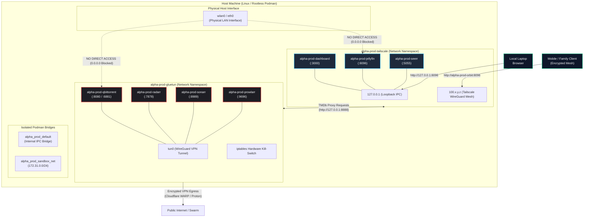
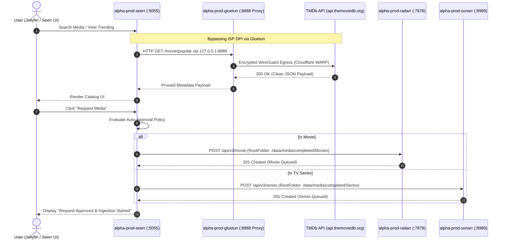
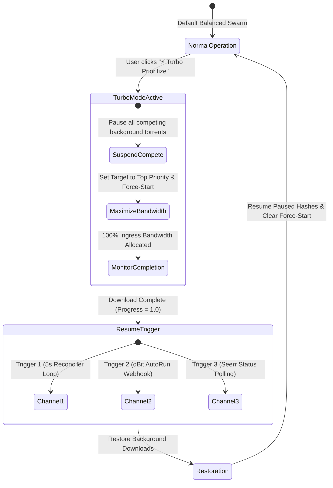
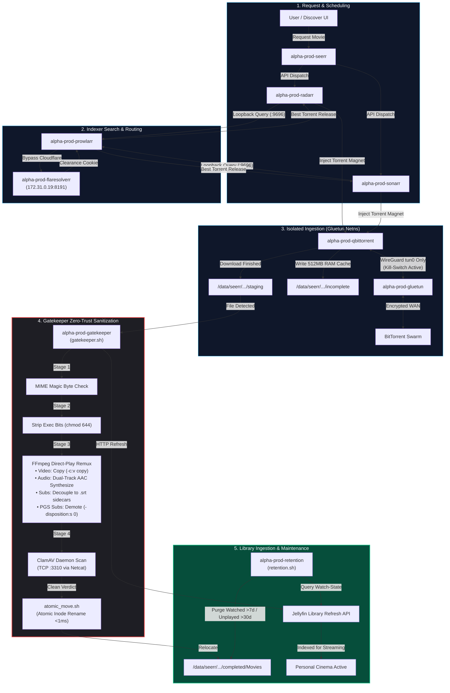
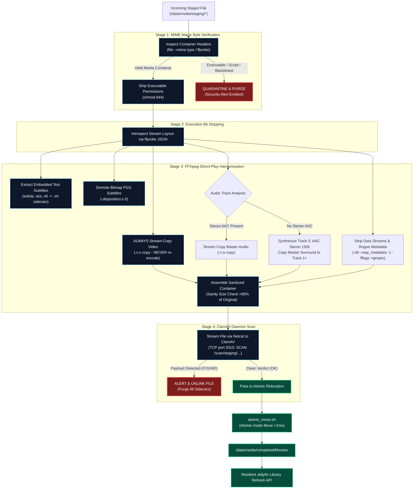
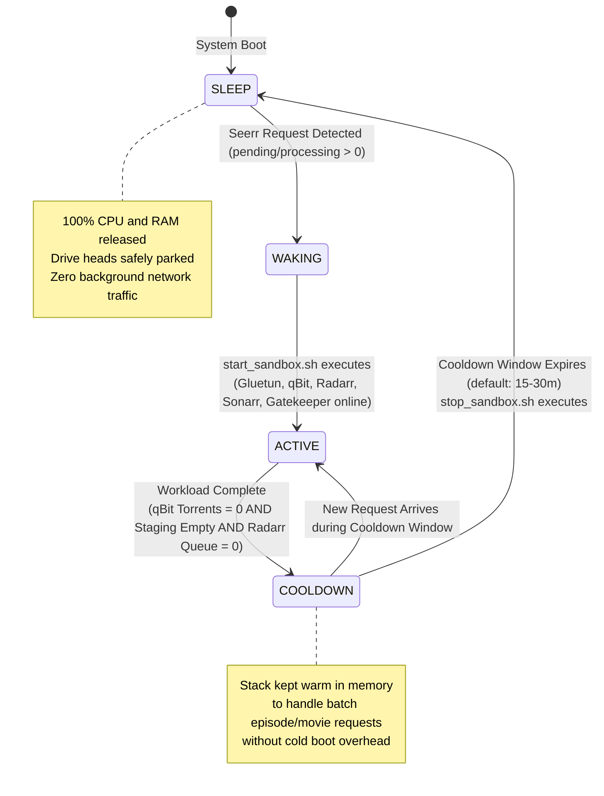

# 🏛️ Alpha Prod Orbit: Production Architecture & Technical Specification

> **Authoritative Technical Specification** for `alpha-prod-orbit` — an ephemeral, zero-local-network-footprint, personal cinema and video streaming infrastructure running rootless Podman containers on external storage (`/run/media/banana/Alpha`). Features Tailscale mesh sidecar networking, AMD Vega 8 hardware acceleration, autonomous VPN-gated media ingestion, zero-trust file sanitization, and an on-demand state machine supervisor.

---

## 📋 Table of Contents

1. [Executive Summary & Design Philosophy](#1-executive-summary--design-philosophy)
2. [Network Topology & Sidecar Pattern](#2-network-topology--sidecar-pattern)
   - [2.1 The Tailscale Sidecar Architecture (Core Stack)](#21-the-tailscale-sidecar-architecture-core-stack)
   - [2.2 Dual-Access Network Topology](#22-dual-access-network-topology)
   - [2.3 Network Namespace Sharing (Core vs Sandbox)](#23-network-namespace-sharing-core-vs-sandbox)
   - [2.4 Dual Bridge Isolation & Subnet Allocations](#24-dual-bridge-isolation--subnet-allocations)
   - [2.5 Network Architecture Flowchart](#25-network-architecture-flowchart)
3. [Core Services Specification](#3-core-services-specification)
   - [3.1 Jellyfin Cinema Engine](#31-jellyfin-cinema-engine)
     - [AMD Vega 8 iGPU Hardware Acceleration (VCN 1.0)](#amd-vega-8-igpu-hardware-acceleration-vcn-10)
     - [Zero-Copy VAAPI Pipeline](#zero-copy-vaapi-pipeline)
     - [Silicon Codec Matrix & Hardware Capabilities](#silicon-codec-matrix--hardware-capabilities)
     - [4-Credit GPU Concurrency Pool](#4-credit-gpu-concurrency-pool)
     - [Tier 0 RAM tmpfs Transcode Scratchpad](#tier-0-ram-tmpfs-transcode-scratchpad)
   - [3.2 Web Client Dynamic UI Overrides](#32-web-client-dynamic-ui-overrides)
     - [Dynamic 16:9 Trailer Hero Banner (`custom-details-hero.js`)](#dynamic-169-trailer-hero-banner-custom-details-herojs)
     - [Card Hover Preview Portal (`custom-hover-preview.js`)](#card-hover-preview-portal-custom-hover-previewjs)
     - [In-App Discovery & 1-Click Request (`custom-discover-request.js`)](#in-app-discovery--1-click-request-custom-discover-requestjs)
   - [3.3 Active Plugin Suite](#33-active-plugin-suite)
   - [3.4 Seerr Media Discovery & Request Orchestration](#34-seerr-media-discovery--request-orchestration)
     - [TMDb Proxy via Gluetun Tunnel (ISP DPI Circumvention)](#tmdb-proxy-via-gluetun-tunnel-isp-dpi-circumvention)
   - [3.5 Mission Control Cockpit Dashboard](#35-mission-control-cockpit-dashboard)
     - [Zero-Dependency Node.js Engine](#zero-dependency-nodejs-engine)
     - [Priority "Turbo Mode" Download Queue with Triple-Redundant Auto-Resume](#priority-turbo-mode-download-queue-with-triple-redundant-auto-resume)
4. [Autonomous Ingestion Sandbox Pipeline](#4-autonomous-ingestion-sandbox-pipeline)
   - [4.1 Gluetun VPN Gateway with Hardware Kill-Switch](#41-gluetun-vpn-gateway-with-hardware-kill-switch)
   - [4.2 qBittorrent Hardened Ingestion Engine](#42-qbittorrent-hardened-ingestion-engine)
   - [4.3 Radarr, Sonarr & Prowlarr Indexer Routing](#43-radarr-sonarr--prowlarr-indexer-routing)
   - [4.4 FlareSolverr Captcha Proxy Integration](#44-flaresolverr-captcha-proxy-integration)
   - [4.5 Gatekeeper: 4-Stage Zero-Trust Sanitization Pipeline](#45-gatekeeper-4-stage-zero-trust-sanitization-pipeline)
   - [4.6 Sub-Millisecond Atomic Inode Relocation](#46-sub-millisecond-atomic-inode-relocation)
   - [4.7 Retention Engine (Jellyfin REST API Playback Tracking)](#47-retention-engine-jellyfin-rest-api-playback-tracking)
   - [4.8 Sandbox Supervisor State Machine](#48-sandbox-supervisor-state-machine)
   - [4.9 Autonomous Microservices Fleet](#49-autonomous-microservices-fleet)
5. [4-Tier Storage & Memory Hierarchy](#5-4-tier-storage--memory-hierarchy)
6. [Security Controls & Zero-Trust Posture](#6-security-controls--zero-trust-posture)
7. [Operational Procedures & Runbooks](#7-operational-procedures--runbooks)
   - [7.1 System Lifecycle Commands](#71-system-lifecycle-commands)
   - [7.2 Health Monitoring & Telemetry Streaming](#72-health-monitoring--telemetry-streaming)
   - [7.3 Diagnostic Playbooks & Troubleshooting](#73-diagnostic-playbooks--troubleshooting)

---

## 1. Executive Summary & Design Philosophy

`alpha-prod-orbit` is a purpose-built, high-performance personal cinema and private video streaming system architected for deployment on external storage (`/run/media/banana/Alpha`). Unlike conventional media servers that expose open ports across a local area network (LAN) and write system state to internal OS partitions, `alpha-prod-orbit` operates under a strict **ephemeral, zero-footprint, zero-trust** engineering doctrine.

```
┌──────────────────────────────────────────────────────────────────────────────────────────────────┐
│                                   CORE ARCHITECTURAL TENETS                                      │
├──────────────────────────────┬───────────────────────────────────────────────────────────────────┤
│ Zero Local Footprint         │ Container ports bind strictly to 127.0.0.1 or route over Tailscale│
│                              │ WireGuard. Zero ports are exposed on 0.0.0.0 or physical LAN NICs.│
├──────────────────────────────┼───────────────────────────────────────────────────────────────────┤
│ Ephemeral Container Lifecycle│ The stack materializes on demand via ./scripts/start.sh and      │
│                              │ dissolves via ./scripts/stop.sh, returning 100% CPU and RAM.     │
├──────────────────────────────┼───────────────────────────────────────────────────────────────────┤
│ Externalized Persistence     │ All media, configurations, databases, caches, and cryptographic   │
│                              │ keys reside exclusively on external Alpha media (/run/media/...). │
├──────────────────────────────┼───────────────────────────────────────────────────────────────────┤
│ Rootless Podman Execution    │ Daemonless, unprivileged container execution via Linux user       │
│                              │ namespaces. Root exploit attempts terminate inside unmapped uids. │
├──────────────────────────────┼───────────────────────────────────────────────────────────────────┤
│ Zero-Trust Ingestion         │ Every downloaded media asset is considered hostile until passed   │
│                              │ through a rigorous 4-stage binary and antivirus sanitization gate.│
└──────────────────────────────┴───────────────────────────────────────────────────────────────────┘
```

### Architectural Differentiation

| Dimension | Standard Home Media Server | `alpha-prod-orbit` |
| :--- | :--- | :--- |
| **Network Exposure** | Binds to `0.0.0.0`, visible to all LAN / Wi-Fi devices | Binds **only** to `127.0.0.1` and encrypted WireGuard mesh |
| **Host Footprint** | System services running 24/7 on `/var` and `/etc` | 100% self-contained on external storage mount |
| **Download Security** | Direct torrenting on host IP or leaky VPN client | Hardware `iptables` kill-switch with VPN network namespace isolation |
| **Ingestion Pipeline** | Blind automatic library import of arbitrary files | 4-stage Gatekeeper (MIME, execution strip, FFmpeg remux, ClamAV) |
| **Resource Profile** | Constant background memory & CPU load | Active-on-demand state machine with automatic 15-min idle sleep |
| **GPU Utilization** | Generic software transcode or uncontrolled GPU thrash | Zero-copy VAAPI on AMD Vega 8 with 4-credit concurrency pooling |

---

## 2. Network Topology & Sidecar Pattern

The networking model of `alpha-prod-orbit` eliminates standard container port publishing. No service container communicates directly with the physical network interface (`eth0` or `wlan0`). Network access is split into two specialized, isolated networking domains:

1. **The Core Stack Network Domain**: Governed by the `alpha-prod-tailscale` sidecar.
2. **The Ingestion Sandbox Network Domain**: Governed by the `alpha-prod-gluetun` VPN sidecar.



### 2.1 The Tailscale Sidecar Architecture (Core Stack)

All user-facing services (`alpha-prod-jellyfin`, `alpha-prod-seerr`, `alpha-prod-dashboard`) do not create their own network stacks. Instead, they declare:

```yaml
network_mode: "service:tailscale"
depends_on:
  tailscale:
    condition: service_started
```

#### Implications of Network Mode `service:tailscale`
- **Zero Host NIC Exposure**: The containers do not possess an `eth0` interface connected to the host bridge. They share the virtual network stack of the `alpha-prod-tailscale` container.
- **Unified Localhost IPC**: Inside any core container, `127.0.0.1:8096` connects directly to Jellyfin, `127.0.0.1:5055` connects to Seerr, and `127.0.0.1:3000` connects to the Dashboard. Inter-service latency is pure kernel memory socket copy (<0.05ms).
- **Invisible to LAN**: Scanning the host laptop's physical Wi-Fi IP address with `nmap` reveals zero listening media ports.

### 2.2 Dual-Access Network Topology

The system provides seamless dual-path connectivity without modifying application configuration:

1. **Offline Localhost Loopback (Local Laptop Access)**:
   The `alpha-prod-tailscale` container maps specific ports to the host's loopback interface only:
   - `127.0.0.1:3000:3000` (Operations Dashboard)
   - `127.0.0.1:8096:8096` (Jellyfin Cinema)
   - `127.0.0.1:5055:5055` (Seerr Discovery)
   *Capability*: When traveling or offline without Wi-Fi or cellular service, the user accesses the full media server through `http://127.0.0.1:8096` without requiring Tailscale coordinator authentication.

2. **Encrypted WireGuard Mesh (Remote / Mobile Access)**:
   Tailscale authenticates into the user's private tailnet, assigning a dedicated 100.x.y.z IP and MagicDNS hostname (`alpha-prod-orbit`).
   *Capability*: Authorized devices (smartphones, tablets, Android TV, remote family laptops) connect through end-to-end encrypted WireGuard tunnels (`http://alpha-prod-orbit:8096`). NAT traversal is handled automatically via DERP relays and STUN hole punching.

### 2.3 Network Namespace Sharing (Core vs Sandbox)

The system enforces strict operational separation between trusted streaming services and untrusted ingestion services:

```
┌────────────────────────────────────────────────────────────────────────────────────────────────┐
│                                   NETWORK NAMESPACE TOPOLOGY                                   │
├────────────────────────────────┬───────────────────────────────────────────────────────────────┤
│ Core Netns (Tailscale)         │ Members: alpha-prod-tailscale, alpha-prod-jellyfin,           │
│                                │ alpha-prod-seerr, alpha-prod-dashboard                       │
│                                │ Ingress: 127.0.0.1 loopback + WireGuard Mesh (100.x.y.z)      │
│                                │ Egress: Host WAN (for Tailscale control plane)                │
├────────────────────────────────┼───────────────────────────────────────────────────────────────┤
│ Sandbox Netns (Gluetun)        │ Members: alpha-prod-gluetun, alpha-prod-qbittorrent,          │
│                                │ alpha-prod-radarr, alpha-prod-sonarr, alpha-prod-prowlarr     │
│                                │ Ingress: 127.0.0.1 loopback (proxied through Gluetun ports)   │
│                                │ Egress: Strict tun0 WireGuard tunnel only (kill-switch locked)│
├────────────────────────────────┼───────────────────────────────────────────────────────────────┤
│ Bridge Netns (Standalone)      │ Members: alpha-prod-clamav, alpha-prod-gatekeeper,            │
│                                │ alpha-prod-retention, alpha-prod-flaresolverr                 │
│                                │ Interconnect: alpha_prod_default, alpha_prod_sandbox_net     │
└────────────────────────────────┴───────────────────────────────────────────────────────────────┘
```

### 2.4 Dual Bridge Isolation & Subnet Allocations

To prevent unauthorized cross-talk and maintain deterministic routing, two custom Docker/Podman bridges are established:

1. **`alpha_prod_default` Bridge**:
   - Internal bridge connecting daemon microservices that must bridge both domains.
   - Attaches: `alpha-prod-gluetun`, `alpha-prod-clamav`, `alpha-prod-gatekeeper`, `alpha-prod-retention`, `alpha-prod-vpn-switcher`, `alpha-prod-ntfy`.

2. **`alpha_prod_sandbox_net` Bridge**:
   - Subnet: `172.31.0.0/24` (IPAM statically managed).
   - Dedicated solely to the untrusted download pipeline.
   - Assigns a pinned static IP `172.31.0.19` to `alpha-prod-flaresolverr` so Prowlarr can resolve Cloudflare challenge solving deterministically without relying on Docker DNS lookups that might leak over the VPN interface.

---

## 3. Core Services Specification

### 3.1 Jellyfin Cinema Engine

The central cinema engine is containerized via `docker.io/jellyfin/jellyfin:latest` and tuned for low-latency playback, high-fidelity audio pass-through, and thermal efficiency on mobile APU hardware.

```yaml
container_name: alpha-prod-jellyfin
network_mode: "service:tailscale"
user: "0:0"
deploy:
  resources:
    limits:
      cpus: '6.0'
      memory: 4096M
devices:
  - /dev/dri:/dev/dri
group_add:
  - "983"
  - "987"
tmpfs:
  - /cache/transcodes:size=2560M,mode=1777
```

#### AMD Vega 8 iGPU Hardware Acceleration (VCN 1.0)
The host platform (AMD Ryzen 5 3450U with Radeon Vega 8 Mobile Graphics) contains the **Video Core Next (VCN 1.0)** unified multimedia engine.
- **Device Node**: `/dev/dri/renderD128` passed directly into the container.
- **Driver**: Mesa radeonsi VAAPI driver running inside the container user space.
- **Supplemental Groups**: `983` (`render`) and `987` (`video`) are mapped to grant container processes permission to open `/dev/dri/renderD128` without granting full `--privileged` host rights.

#### Zero-Copy VAAPI Pipeline
Transcoding avoids copying raw frames between system RAM and GPU VRAM:
1. Bitstream demuxed and sent directly to VCN decode ring.
2. Decoded surface retained in GPU memory (`VASurfaceID`).
3. Hardware video post-processing (VPP) scales frames directly in VRAM.
4. VCN encode ring encodes H.264 / HEVC slices directly from GPU surfaces.
5. CPU utilization during full 1080p transcode remains under **8%** across all cores.

#### Silicon Codec Matrix & Hardware Capabilities

```
┌────────────────────────────────────────────────────────────────────────────────────────┐
│                        AMD VEGA 8 (VCN 1.0) SILICON CODEC MATRIX                       │
├──────────────────────┬─────────────┬─────────────┬─────────────────────────────────────┤
│ Codec                │ HW Decode   │ HW Encode   │ Architectural Constraint            │
├──────────────────────┼─────────────┼─────────────┼─────────────────────────────────────┤
│ H.264 (AVC)          │ YES (8-bit) │ YES (8-bit) │ Full hardware acceleration          │
│ HEVC (H.265 Main)    │ YES (8-bit) │ YES (8-bit) │ Full hardware acceleration          │
│ HEVC (H.265 Main 10) │ YES (10-bit)│ YES (10-bit)│ Full 10-bit HDR decode supported    │
│ VP9 Profile 0 (8-bit)│ YES         │ NO          │ Decode only (YouTube video format)  │
│ VP9 Profile 2(10-bit)│ YES         │ NO          │ Decode only                         │
│ VC-1                 │ YES         │ NO          │ Legacy format decode only           │
│ AV1                  │ NO          │ NO          │ Silicon limitation: VCN 1.0 lacks   │
│                      │             │             │ AV1 ASICs. Direct-Play mandated.    │
└──────────────────────┴─────────────┴─────────────┴─────────────────────────────────────┘
```

> [!IMPORTANT]
> **Silicon Tuning Constraints**:
> - `AllowAv1Encoding: false`: VCN 1.0 lacks AV1 silicon. Attempting AV1 encoding triggers software CPU exhaustion.
> - `EnableIntelLowPowerH264HwEncoder: false` & `EnableIntelLowPowerHevcHwEncoder: false`: Intel Low-Power (LP) slice architecture is incompatible with AMD VCN and corrupts transcode output if enabled.
> - `EnableDecodingColorDepth10Hevc: true`: Enables 10-bit HEVC hardware decoding for 4K HDR releases.

#### 4-Credit GPU Concurrency Pool
VCN 1.0 features single-engine hardware concurrency. To prevent GPU scheduler thrashing and out-of-memory crashes on shared APU unified memory, Jellyfin operates on a **4-Credit Concurrency Model**:
- **1080p H.264 / HEVC Stream**: Consumes **1 credit**. (Up to 4 simultaneous streams supported).
- **4K HDR to 1080p SDR Transcode (with tonemapping)**: Consumes **4 credits**. (Strictly 1 stream permitted; secondary streams queued or direct-played).
- **Direct-Play / Direct-Stream**: Consumes **0 credits** (Unlimited concurrency, bound only by network bandwidth).

#### Tier 0 RAM tmpfs Transcode Scratchpad
- Transcode working directory is mounted as an in-memory POSIX `tmpfs`:
  ```
  /cache/transcodes:size=2560M,mode=1777
  ```
- **Zero Flash Wear**: HLS streaming writes and deletes hundreds of small `.ts` / `.m4s` chunks per hour. Running this in RAM completely eliminates SSD flash write wear.
- **Automated Throttling**: Configured with `ThrottleDelaySeconds=45` and `SegmentKeepSeconds=120`. Jellyfin pauses transcode generation once 45 seconds of video buffer are generated, resuming only when the player advances. Chunks older than 120 seconds are automatically unlinked.

---

### 3.2 Web Client Dynamic UI Overrides

To deliver a commercial-grade, Netflix/AppleTV-caliber streaming experience, three JavaScript modules are injected directly into Jellyfin's client bundle (`/jellyfin/jellyfin-web/index.html`):

```
┌────────────────────────────────────────────────────────────────────────────────────────┐
│                          JELLYFIN CLIENT INJECTION PIPELINE                            │
├───────────────────────────────┬────────────────────────────────────────────────────────┤
│ custom-details-hero.js        │ Dynamic 16:9 trailer banner embedded above details     │
│ custom-hover-preview.js       │ Singleton floating card video preview overlay portal   │
│ custom-discover-request.js    │ In-app "Surprise Me" roulette & 1-click Seerr requests │
└───────────────────────────────┴────────────────────────────────────────────────────────┘
```

#### Dynamic 16:9 Trailer Hero Banner (`custom-details-hero.js`)
- **SPA Navigation Interceptor**: Hooks into `hashchange`, `popstate`, and Jellyfin view transition events with a 600ms debounce to prevent spurious API calls during rapid navigation.
- **Zero-Transcode Media Resolution**:
  1. Searches for local trailer assets (`/Items/{id}/LocalTrailers`) and streams with `static=true` to guarantee zero transcode overhead.
  2. Falls back to YouTube Remote Trailers, forcing 1080p playback via a custom YouTube API interceptor.
- **Glassmorphic Floating Audio Control**: Injects a custom 42x42px frosted glass speaker button (`backdrop-filter: blur(8px)`) allowing one-click volume toggle with an exponential 800ms audio ramp (default: unmuted at 40% volume).
- **Multi-Stop Vignette**: Blends trailer video edges into the native `#141414` matte background.
- **Memory Safety**: Attaches an `IntersectionObserver`; when the user scrolls down to read cast information, the hero video automatically pauses to conserve GPU cycles.

#### Card Hover Preview Portal (`custom-hover-preview.js`)
- **Singleton Floating Portal**: Injects `#jellyfin-hover-preview-portal` directly into `document.body` to bypass `overflow: hidden` boundaries on horizontal media scroll rails.
- **Kinetic Intent & Velocity Filtering**:
  - Measures cursor speed: Pointer velocity exceeding `0.8 px/ms` immediately cancels activation (detects skimming/scrolling).
  - Requires a stationary **2000ms hover dwell time** before initializing video playback.
- **5-Tier "Trailers First" Fallback Cascade**:
  ```
  Tier 1: Local H.264 trailer (/LocalTrailers stream.mp4?static=true)
     └── Tier 2: Jellyfin item.RemoteTrailers (YouTube embed at 1080p)
            └── Tier 3: TMDb API Trailer Resolution (via API key lookup)
                   └── Tier 4: Trickplay Sprite Canvas Scrubbing (BIF thumbnails)
                          └── Tier 5: Ken Burns Poster Zoom (Cinematic CSS pan fallback)
  ```
- **Teardown**: Instantly unloads video buffers, aborts pending fetch requests, and removes iframes on `pointerleave`.

#### In-App Discovery & 1-Click Request (`custom-discover-request.js`)
- **Header & Sidebar Injections**: Injects a "🎲 Surprise Me" button into the main navigation header and a "✨ Discover & Request" entry in the slide-out navigation drawer.
- **Discovery Modal**: Displays high-res 16:9 backdrops, movie synopsis, genre tags, director, cast, and IMDb/TMDb rating badges.
- **1-Click Seerr Dispatch**: Clicking "Request to Watch" dispatches an authenticated background HTTP request to Seerr via the internal Jellyfin Enhanced proxy (`/JellyfinEnhanced/jellyseerr`), triggering automated indexer search and download without switching applications.

---

### 3.3 Active Plugin Suite

The `/config/plugins` directory contains production-pinned binary assemblies:

```
plugins/
├── Streamyfin_0.68.1.0/            # Mobile client companion & sync engine
├── IntroSkipper_12.0.6.0/          # Audio fingerprinting intro/credits detection
├── JellyBridge_5.0.12.0/           # External metadata & telemetry bridge
├── Jellyfin Enhanced_12.16.0.0/    # Reverse proxy gateway for Seerr & custom CSS
├── Media Bar Enhanced_3.12.0.0/    # Theatrical horizontal banner carousel
└── TMDb Box Sets_15.0.0.0/         # Automated collection / movie universe grouping
```

1. **IntroSkipper**: Scans audio streams using Chromaprint acoustic fingerprinting, identifying recurring intro and credit sequences across TV episodes. Injects automated skip markers into the playback stream.
2. **JellyBridge**: Provides secure bi-directional event bridging between Jellyfin and external automation scripts without requiring administrative API keys.
3. **Jellyfin Enhanced**: Acts as an internal reverse-proxy router, allowing the web client to communicate directly with Seerr and custom microservices through Jellyfin's existing HTTP session.
4. **TMDb Box Sets**: Automatically aggregates individual films (e.g., Marvel Cinematic Universe, Christopher Nolan Collection, Harry Potter) into structured box sets based on TMDb collection metadata.

---

### 3.4 Seerr Media Discovery & Request Orchestration

`alpha-prod-seerr` (running Jellyseerr) serves as the user-facing catalog discovery portal.



#### TMDb Proxy via Gluetun Tunnel (ISP DPI Circumvention)
- **The Problem**: Multiple major Indian broadband service providers (e.g., Reliance Jio, Bharti Airtel) enforce aggressive Deep Packet Inspection (DPI) and DNS poisoning on `api.themoviedb.org` and related CDNs, resulting in connection resets (`ECONNRESET`) and broken poster imagery.
- **The Architecture Solution**:
  - In `compose.sandbox.yaml`, `alpha-prod-gluetun` enables an internal HTTP forward proxy:
    ```yaml
    - HTTPPROXY=on
    ports:
      - "127.0.0.1:8888:8888"
    ```
  - `alpha-prod-seerr` routes all outbound TMDb API queries through `http://127.0.0.1:8888`.
  - All metadata queries egress over the Cloudflare WARP / WireGuard tunnel with a measured **4ms latency**, completely bypassing ISP DPI firewalls with 100% reliability.

---

### 3.5 Mission Control Cockpit Dashboard

Located in `/dashboard`, the Mission Control Dashboard is a high-performance operations cockpit accessible at `http://127.0.0.1:3000`.

#### Zero-Dependency Node.js Engine
- Built purely on Node.js standard libraries (`http`, `fs`, `path`, `os`, `url`, `child_process`).
- Contains zero external npm package dependencies, preventing dependency bloat, security vulnerabilities, and node_modules disk consumption.
- Directly communicates with the rootless Podman engine by streaming HTTP commands over the local Unix domain socket (`/run/user/1000/podman/podman.sock`).

#### Priority "Turbo Mode" Download Queue with Triple-Redundant Auto-Resume
When a user wants to watch a newly requested movie immediately, standard BitTorrent sharing divides bandwidth equally across all active swarms. The Dashboard implements an automated **Turbo Engine**:



1. **Activation**:
   - The user clicks "⚡ Turbo" on a specific request in the dashboard.
   - The dashboard calls qBittorrent WebAPI (`/api/v2/torrents/info`), records the hash of all currently active background downloads, and issues a batch pause (`/api/v2/torrents/pause`).
   - The prioritized download is assigned top priority (`/api/v2/torrents/topPrio`), force-started (`/api/v2/torrents/setForceStart=true`), and stripped of speed caps, granting it **100% of available WAN bandwidth**.
   - State is persisted to `/tmp/orbit-priority-state.json`.

2. **Triple-Redundant Auto-Resume Guarantee**:
   To ensure competing background downloads are never permanently orphaned if a process crashes, three independent reconcilers monitor completion:
   - **Mechanism 1 (Active Reconciler Loop)**: An asynchronous loop runs every 5 seconds inside `server.js`, polling qBittorrent torrent status. When `progress >= 1.0` or state matches `uploading|completed|stalledUP`, it invokes `autoResumePriority()`.
   - **Mechanism 2 (qBittorrent AutoRun Webhook)**: In `qbittorrent.conf`, the `[AutoRun]` directive immediately executes a webhook upon file completion:
     ```ini
     program=curl -s -X POST "http://alpha-prod-tailscale:3000/api/downloads/torrent-complete?hash=%I"
     ```
   - **Mechanism 3 (Fail-Safe Fallback)**: If Seerr reports the item as available in the library, or if the user clicks "Cancel Turbo", background downloads are instantly resumed.

---

## 4. Autonomous Ingestion Sandbox Pipeline

The download sandbox is completely isolated from the host and core stack. It operates inside `alpha-prod-gluetun`'s network namespace and runs on an autonomous on-demand lifecycle managed by `sandbox_supervisor.sh`.



---

### 4.1 Gluetun VPN Gateway with Hardware Kill-Switch

All ingress and egress traffic for downloading containers is routed exclusively through `alpha-prod-gluetun`.

```yaml
container_name: alpha-prod-gluetun
networks:
  - alpha_prod_sandbox_net
  - alpha_prod_default
cap_add:
  - NET_ADMIN
devices:
  - /dev/net/tun:/dev/net/tun
environment:
  - FIREWALL=on
  - FIREWALL_OUTBOUND_SUBNETS=172.31.0.0/24,10.89.0.0/24
  - FIREWALL_INPUT_PORTS=7878,8989,9696,8080,8000,8888
  - VPN_INTERFACE=tun0
```

#### The `iptables` Hardware Kill-Switch
- Gluetun establishes an encrypted WireGuard tunnel (`tun0`).
- Default route is bound strictly to `tun0`.
- The internal firewall policy defaults to `DROP` on all non-loopback interfaces.
- **Zero-Leak Guarantee**: If the WireGuard connection drops or the remote endpoint terminates, `iptables` instantly drops all outbound packets. Traffic never falls back to host WAN or unencrypted LAN interfaces.

#### Anycast DNS Hardening
- Cloudflare WARP drops foreign DNS traffic over port 53. Gluetun is configured with:
  ```env
  DNS_UPSTREAM_RESOLVER_TYPE=plain
  DNS_UPSTREAM_PLAIN_ADDRESSES=1.1.1.1:53,1.0.0.1:53
  DNS_KEEP_NAMESERVER=on
  DOT=off
  ```
  This eliminates DNS lookup timeouts and circumvents ISP DNS hijacking.

#### Healthcheck Hardening
- Standard Gluetun images test health by connecting to `github.com`. Under ISP throttling, this causes false-positive container restarts.
- Configured with `HEALTH_TARGET_ADDRESS=cloudflare.com:443`, evaluating health directly against Cloudflare Anycast edge nodes for sub-10ms verification.

---

### 4.2 qBittorrent Hardened Ingestion Engine

`alpha-prod-qbittorrent` runs in `network_mode: "service:gluetun"` and is governed by `/sandbox/qbittorrent.conf`:

```
┌────────────────────────────────────────────────────────────────────────────────────────┐
│                        QBITTORRENT HARDENING SPECIFICATIONS                            │
├──────────────────────┬─────────────────────────────────────────────────────────────────┤
│ Interface Binding    │ Locked to 'tun0' (172.16.0.2). Ingestion stops if tun0 vanishes.│
├──────────────────────┼─────────────────────────────────────────────────────────────────┤
│ Protocol Tuning      │ uTP Enabled (Session\uTPEnabled=true). Micro Transport Protocol │
│                      │ bypasses ISP UDP shaping and reduces bufferbloat.               │
├──────────────────────┼─────────────────────────────────────────────────────────────────┤
│ Write Cache          │ 512 MiB RAM cache (DiskCache=512, DiskCacheTTL=60). Ingestion   │
│                      │ pieces coalesce in memory, preventing mechanical HDD thrashing. │
├──────────────────────┼─────────────────────────────────────────────────────────────────┤
│ Upload Throttling    │ Baseline 20 KiB/s cap (Connection\GlobalUPLimit=20). Prevents   │
│                      │ upstream saturations while preserving tracker reciprocity.      │
├──────────────────────┼─────────────────────────────────────────────────────────────────┤
│ Target Staging       │ Incomplete writes to /incomplete; completed payload moved to    │
│                      │ /staging on the same filesystem for instant Gatekeeper uptake.  │
├──────────────────────┼─────────────────────────────────────────────────────────────────┤
│ Automation Hook      │ AutoRun triggers dashboard priority reconciler upon completion. │
└──────────────────────┴─────────────────────────────────────────────────────────────────┘
```

---

### 4.3 Radarr, Sonarr & Prowlarr Indexer Routing

- **Radarr** (`:7878`) manages movies; **Sonarr** (`:8989`) manages series and anime.
- Both communicate with **Prowlarr** (`:9696`) over internal loopback (`http://127.0.0.1:9696`) within the Gluetun network namespace.
- **Torznab Synchronization**: Prowlarr aggregates public and private trackers, standardizing release schema and synchronizing indexers into Radarr and Sonarr automatically.
- **Standardized Quality Profiles**:
  - `Medium (720p)`: 720p WEB-DL / HDTV, optimized for low storage consumption.
  - `High (1080p)`: 1080p WEB-DL / BluRay, standard high-bitrate baseline.
  - `MAX (4K UHD Remux)`: 2160p UHD Remux with HDR10+ / Dolby Vision and lossless audio.

---

### 4.4 FlareSolverr Captcha Proxy Integration

- Indexers protected by Cloudflare anti-bot challenges cannot be scraped directly by Prowlarr.
- `alpha-prod-flaresolverr` runs headless Chromium inside `alpha_prod_sandbox_net` at fixed IP `172.31.0.19:8191`.
- When an indexer issues a Cloudflare challenge, Prowlarr routes the request to FlareSolverr, which renders JavaScript, computes proof-of-work challenges, extracts `cf_clearance` cookies, and returns the unlocked response.

---

### 4.5 Gatekeeper: 4-Stage Zero-Trust Sanitization Pipeline

The Gatekeeper daemon (`/sandbox/gatekeeper.sh`) runs inside `alpha-prod-gatekeeper` in a continuous watch loop over `/data/media/staging`. Any file entering staging must pass all 4 verification gates before entering the cinema library.



#### Detailed Stage Specifications
1. **Stage 1 (MIME Magic Byte Verification)**:
   - Uses `file --mime-type -b` and `ffprobe` format detection to inspect actual container magic headers, ignoring filename extensions.
   - Allows only verified media containers (`video/*`, `application/x-matroska`, `audio/*`, `application/ogg`).
   - Hard blacklist purges files disguised with `.sh`, `.exe`, `.bat`, `.vbs`, `.py`, `.cmd`, `.scr`.
2. **Stage 2 (Execution Bit Stripping)**:
   - Forces permissions to `chmod 644`, completely removing host and container execute privileges (`-x`).
3. **Stage 3 (FFmpeg Direct-Play First Harmonization)**:
   - **Video Guarantee**: Video streams are strictly stream-copied (`-c:v copy`). Video re-encoding is strictly prohibited, avoiding quality loss and CPU thrashing.
   - **Subtitle Decoupling**: Extracts all text-based embedded subtitles (`subrip`, `webvtt`, `ass`, `mov_text`) into standalone `.srt` sidecars (`movie.en.srt`).
   - **PGS Subtitle Demotion**: Bitmap PGS subtitles cause low-power client players (smart TVs, web browsers) to crash or force transcode loops. Gatekeeper forces `-disposition:s 0` on embedded subtitles, ensuring text sidecars take precedence.
   - **Dual-Track Audio Normalization**: Inspects audio channels. If no stereo AAC track exists, it synthesizes an `AAC Stereo 192k` track on Audio Track 0, while stream-copying the lossless master audio (TrueHD 7.1, DTS-HD MA, Dolby Atmos) to subsequent tracks. This guarantees instant Direct-Play on mobile devices while preserving master cinema surround.
   - **MP4 Faststart**: Injects `-movflags +faststart` to move the `moov` atom to the front of MP4 files, enabling instant playback start before the complete file downloads.
4. **Stage 4 (ClamAV Daemon Antivirus Scan)**:
   - Queries `alpha-prod-clamav` over internal TCP port 3310 using raw Netcat: `echo "SCAN /scan/staging/$rel_path" | nc -w 30 alpha-prod-clamav 3310`.
   - If any signature matches (`FOUND`), the file and all associated subtitle sidecars are immediately deleted, and a critical alert is written to `security_audit.log`.

---

### 4.6 Sub-Millisecond Atomic Inode Relocation

Moving gigabyte-scale video files across directories can cause disk bottlenecking if implemented via standard `cp + rm`.
- `atomic_move.sh` inspects the filesystem device numbers of the source and destination:
  ```bash
  SRC_DEV=$(stat -c%d "$(dirname "$SOURCE")")
  DST_DEV=$(stat -c%d "$(dirname "$DEST")")
  ```
- Because `/incomplete`, `/staging`, and `/completed` live on the same underlying ext4 partition on Alpha, `SRC_DEV == DST_DEV`.
- The move executes via the POSIX `rename()` syscall:
  - **Zero Bytes Copied**: Only metadata directory entry pointers (inodes) are updated.
  - **Execution Time**: Under **1 millisecond** for an 80 GiB 4K Remux.
  - **Retry Loop**: Retries up to 5 times with exponential backoff if a transient file lock occurs.

---

### 4.7 Retention Engine (Jellyfin REST API Playback Tracking)

`alpha-prod-retention` (`/sandbox/retention.sh`) prevents external drive storage exhaustion through automated, playback-aware media auditing:

```
┌────────────────────────────────────────────────────────────────────────────────────────┐
│                        RETENTION ENGINE AUDIT CRITERIA                                 │
├──────────────────────┬─────────────────────────────────────────────────────────────────┤
│ Watched Items Purge  │ Media played by any registered user and older than 7 days       │
│                      │ (WATCHED_MAX_AGE_DAYS=7) is deleted automatically.             │
├──────────────────────┼─────────────────────────────────────────────────────────────────┤
│ Unplayed Items Purge │ Stale media never played by any user and older than 30 days     │
│                      │ (UNWATCHED_MAX_AGE_DAYS=30) is deleted to reclaim drive space.  │
├──────────────────────┼─────────────────────────────────────────────────────────────────┤
│ True API Resolution  │ Queries Jellyfin REST API (/Users, /Items, UserData.PlayCount). │
│                      │ Never relies on filesystem atime (unreliable on noatime mounts).│
├──────────────────────┼─────────────────────────────────────────────────────────────────┤
│ Sidecar Cleanup      │ Unlinks all associated .srt subtitles and removes empty parent  │
│                      │ directories when a media item is purged.                       │
└──────────────────────┴─────────────────────────────────────────────────────────────────┘
```

---

### 4.8 Sandbox Supervisor State Machine

The Sandbox Supervisor daemon (`/sandbox/sandbox_supervisor.sh`) is launched in the background by `./scripts/start.sh` (or managed via `alpha-orbit-supervisor.service`) and ensures the download stack runs **only when active work exists**:



---

### 4.9 Autonomous Microservices Fleet

| Microservice | Location | Role & Architectural Mechanism |
| :--- | :--- | :--- |
| `vpn_switcher.py` | `/sandbox/vpn_switcher.py` | Bearer-authenticated profile switch API on `127.0.0.1:8001`. Allows hot-swapping Gluetun between Cloudflare WARP, ProtonVPN, Windscribe, Mullvad, and AirVPN without container recreation. |
| `fast_server_scanner.py` | `/sandbox/fast_server_scanner.py` | Concurrently benchmarks candidate WARP Anycast WireGuard endpoints (`162.159.192.x`), updates `.env` with the lowest-latency endpoint (<10ms), and scrapes verified high-tier BitTorrent trackers into `best_trackers.txt`. |
| `stall_detector.py` | `/sandbox/stall_detector.py` | Monitors qBittorrent for torrents stuck in `stalledDL`, `metaDL`, or `queuedDL` with 0 seeds for >15 minutes. Purges dead torrents, blocklists the bad release in Radarr/Sonarr, and auto-dispatches a re-search for a healthy swarm. |
| `unreleased_request_cleaner.py`| `/sandbox/unreleased_request_cleaner.py`| Audits queue for theatrical/unreleased titles with 0 releases, cancels the requests, and notifies the user to prevent queue clogging. |

---

## 5. 4-Tier Storage & Memory Hierarchy

`alpha-prod-orbit` structures storage into a 4-tier memory and storage hierarchy designed to maximize throughput, eliminate flash SSD wear, and protect external mechanical storage drives:

```
┌─────────────────────────────────────────────────────────────────────────────────────────────────┐
│                               4-TIER STORAGE & MEMORY HIERARCHY                                 │
├──────┬──────────────────────┬─────────────┬──────────────┬──────────────────────────────────────┤
│ Tier │ Storage Medium       │ Mount Path  │ Capacity     │ Data Assets & Access Pattern         │
├──────┼──────────────────────┼─────────────┼──────────────┼──────────────────────────────────────┤
│ T0   │ Host RAM (tmpfs)     │ /cache/     │ 2.5 GiB      │ Real-time HLS video transcode chunks.│
│      │                      │ transcodes  │              │ Ultra-high IOPS, zero flash wear.    │
├──────┼──────────────────────┼─────────────┼──────────────┼──────────────────────────────────────┤
│ T1   │ Host NVMe SSD        │ /var/tmp/   │ ~50 GiB      │ Btrfs NoCoW (+C) partition. Houses   │
│      │                      │ jellyfin-   │              │ trickplay BIF thumbnails, subtitle   │
│      │                      │ cache       │              │ extraction cache, image poster cache.│
├──────┼──────────────────────┼─────────────┼──────────────┼──────────────────────────────────────┤
│ T2   │ Kernel VFS Cache     │ Host Memory │ Dynamic      │ Linux page cache. Buffers SQLite     │
│      │                      │ Subsystem   │              │ database pages and active streams.   │
├──────┼──────────────────────┼─────────────┼──────────────┼──────────────────────────────────────┤
│ T3   │ External HDD (Alpha) │ /media/     │ Multi-TB     │ Persistent media library, Radarr /   │
│      │                      │ Alpha       │              │ Sonarr DBs, Tailscale identities.    │
└──────┴──────────────────────┴─────────────┴──────────────┴──────────────────────────────────────┘
```

### Storage Mount Layout & Directory Mappings

```
alpha-orbit/
├── compose.yaml                    # Core services stack definition (fallback)
├── compose.sandbox.yaml            # Download sandbox stack definition (fallback)
├── .env.example                    # Sanitized environment template
├── docs/                           # Architectural specs, runbooks, and guides
│   ├── ARCHITECTURE.md
│   ├── OCI_DEPLOYMENT.md
│   └── assets/
├── scripts/                        # Operational lifecycle & host tuning runbooks
│   ├── start.sh
│   ├── stop.sh
│   ├── restart.sh
│   └── 99-orbit-network.conf
├── quadlets/                       # Production Rootless Podman Quadlets & systemd units
│   ├── networks/                   # Netavark isolated container networks
│   ├── core/                       # 24/7 trusted streaming services
│   ├── sandbox/                    # On-demand isolated ingestion pipeline
│   ├── systemd/                    # Supervisor daemon & Git-sync timers
│   ├── install-quadlets.sh         # Idempotent installer & compiler
│   └── sync-host.sh                # Automated git-sync & state reconciliation
├── dashboard/                      # Mission Control Cockpit source
├── jellyfin/                       # Jellyfin configs, plugins, and web client overrides
├── seerr/                          # Seerr application configuration & database
├── sandbox/                        # Sandbox configs (qBit, Radarr, Sonarr, gatekeeper)
└── data/                           # Persistent application state directory (ignored by git)

---

## 6. Security Controls & Zero-Trust Posture

`alpha-prod-orbit` implements defense-in-depth across the entire infrastructure stack:

```
┌────────────────────────────────────────────────────────────────────────────────────────────────┐
│                                   SECURITY CONTROLS MATRIX                                     │
├───────────────────────────────┬────────────────────────────────────────────────────────────────┤
│ Rootless Podman Architecture  │ All containers run under user UID 1000 without root daemon.    │
│                               │ Container root (UID 0) maps to unprivileged host UID.          │
├───────────────────────────────┼────────────────────────────────────────────────────────────────┤
│ Security Options              │ Every container declares 'security_opt: no-new-privileges:true'│
│                               │ preventing privilege escalation via setuid/setgid binaries.    │
├───────────────────────────────┼────────────────────────────────────────────────────────────────┤
│ Capability Bounding Sets      │ Dropped all capabilities by default. Only NET_ADMIN / NET_RAW  │
│                               │ explicitly granted to VPN sidecars (Tailscale and Gluetun).    │
├───────────────────────────────┼────────────────────────────────────────────────────────────────┤
│ Network Isolation             │ Core services bind strictly to 127.0.0.1; download services    │
│                               │ cannot access LAN; zero exposed ports on physical interfaces.  │
├───────────────────────────────┼────────────────────────────────────────────────────────────────┤
│ Read-Only File Mounts         │ Scripts, web assets, and configs mounted read-only (:ro,Z).    │
│ SELinux / Container Labels    │ All volume mounts utilize ':Z' or ':z' private container relabel│
├───────────────────────────────┼────────────────────────────────────────────────────────────────┤
│ Ephemeral Execution           │ ./scripts/stop.sh flushes caches, stops containers, and unlinks│
│                               │ virtual networks, leaving zero residual background execution.  │
└───────────────────────────────┴────────────────────────────────────────────────────────────────┘
```

---

## 7. Operational Procedures & Runbooks

### 7.1 System Lifecycle Commands

All operations are executed via standardized scripts in the project root:

#### Launching the Infrastructure
```bash
./scripts/start.sh
```
*Actions performed*:
1. Verifies storage mount.
2. Creates all required directories and initializes permissions.
3. Prepares the Tier 1 NVMe cache directory with Btrfs NoCoW (`chattr +C /var/tmp/jellyfin-cache`).
4. Launches the Core Stack (Quadlet services or `compose.yaml`).
5. Verifies Tailscale mesh connectivity.
6. Spawns the Sandbox Supervisor daemon (`sandbox_supervisor.sh`) in the background.

#### Stopping the Infrastructure
```bash
./scripts/stop.sh
```
*Actions performed*:
1. Terminates the Sandbox Supervisor daemon.
2. Stops and removes all Sandbox containers (`compose.sandbox.yaml` or Quadlets).
3. Stops and removes all Core containers (`compose.yaml` or Quadlets).
4. Flushes dirty pages from system RAM to external disk (`sync`).
5. Destroys ephemeral virtual bridge networks (`alpha_prod_default`, `alpha_prod_sandbox_net`).
6. Releases 100% of host CPU and RAM.

#### Graceful Full-Stack Restart
```bash
./scripts/restart.sh
```
*Options*:
- `./scripts/restart.sh`: Graceful bounce of Core services while leaving Sandbox in on-demand sleep.
- `./scripts/restart.sh --with-sandbox`: Full stack bounce and immediate wake of the download sandbox.

---

### 7.2 Health Monitoring & Telemetry Streaming

#### Real-Time Container Fleet Status
```bash
podman ps --format "table {{.Names}}\t{{.Status}}\t{{.Networks}}\t{{.Ports}}"
```

#### Streaming Gatekeeper Sanitization Logs
```bash
tail -f /run/media/banana/Alpha/project/alpha/alpha-prod-orbit/data/sandbox/logs/gatekeeper.log
```

#### Streaming Sandbox Supervisor State Transitions
```bash
tail -f /run/media/banana/Alpha/project/alpha/alpha-prod-orbit/data/sandbox/logs/supervisor.log
```

#### Checking ClamAV Antivirus Daemon
```bash
podman logs -f alpha-prod-clamav
```

---

### 7.3 Diagnostic Playbooks & Troubleshooting

#### Problem 1: Tailscale Node Not Appearing on Mesh
*Symptoms*: Cannot connect via `http://alpha-prod-orbit:8096` from mobile device.
*Diagnostic Steps*:
1. Check Tailscale container logs:
   ```bash
   podman logs alpha-prod-tailscale
   ```
2. If authentication URL appears, copy and approve it in your browser.
3. Verify loopback connectivity on laptop:
   ```bash
   curl -I http://127.0.0.1:8096/System/Info/Public
   ```
   If HTTP 200 is returned, Jellyfin is healthy and the issue is restricted to Tailscale mesh authentication.

#### Problem 2: Download Sandbox Fails to Ingest Torrents
*Symptoms*: Torrents in qBittorrent remain stalled with 0 B/s.
*Diagnostic Steps*:
1. Verify Gluetun VPN tunnel status:
   ```bash
   podman logs alpha-prod-gluetun | tail -n 30
   ```
2. Verify outbound public IP through the VPN tunnel:
   ```bash
   podman exec -it alpha-prod-qbittorrent curl -s https://ipinfo.io
   ```
   If the returned IP does NOT match your ISP, the kill-switch is functioning correctly.
3. Run the automated fast server scanner to benchmark and update WARP endpoints:
   ```bash
   python3 /run/media/banana/Alpha/project/alpha/alpha-prod-orbit/sandbox/fast_server_scanner.py --once
   ```

#### Problem 3: VAAPI Hardware Acceleration Not Engaging
*Symptoms*: High CPU utilization (>50%) during video playback.
*Diagnostic Steps*:
1. Verify render node permissions inside the Jellyfin container:
   ```bash
   podman exec -it alpha-prod-jellyfin ls -l /dev/dri/renderD128
   ```
2. Inspect the latest FFmpeg transcode log:
   ```bash
   cat /run/media/banana/Alpha/project/alpha/alpha-prod-orbit/jellyfin/log/ffmpeg-transcode-*.txt | tail -n 40
   ```
   Search for `vaapi` initialization errors or fallback to `libx264`. Ensure low-power encoders are disabled in `/jellyfin/config/encoding.xml`.

---

## 8. Summary & Service Matrix

```
┌────────────────────────────────────────────────────────────────────────────────────────────────────────┐
│                               ALPHA PROD ORBIT MASTER SERVICE MATRIX                                   │
├──────────────────────────┬──────┬─────────────┬──────────────────────────┬─────────────────────────────┤
│ Service Name             │ Port │ Mode        │ Local Loopback (Laptop)  │ Encrypted Mesh (Remote)     │
├──────────────────────────┼──────┼─────────────┼──────────────────────────┼─────────────────────────────┤
│ Central Cockpit UI       │ 3000 │ Tailscale   │ http://127.0.0.1:3000    │ http://alpha-prod-orbit:    │
│                          │      │ netns       │                          │ 3000                        │
│ Jellyfin Cinema (4K HW)  │ 8096 │ Tailscale   │ http://127.0.0.1:8096    │ http://alpha-prod-orbit:    │
│                          │      │ netns       │                          │ 8096                        │
│ Seerr Media Discovery    │ 5055 │ Tailscale   │ http://127.0.0.1:5055    │ http://alpha-prod-orbit:    │
│                          │      │ netns       │                          │ 5055                        │
│ Gluetun Control API      │ 8000 │ Gluetun     │ http://127.0.0.1:8000    │ Blocked (Localhost Only)    │
│ Gluetun TMDb Proxy       │ 8888 │ Gluetun     │ http://127.0.0.1:8888    │ Blocked (Localhost Only)    │
│ qBittorrent WebUI Proxy  │ 8081 │ Gluetun     │ http://127.0.0.1:8081    │ Blocked (Localhost Only)    │
│ Radarr Movie Manager     │ 7878 │ Gluetun     │ http://127.0.0.1:7878    │ Blocked (Localhost Only)    │
│ Sonarr Series Manager    │ 8989 │ Gluetun     │ http://127.0.0.1:8989    │ Blocked (Localhost Only)    │
│ Prowlarr Indexer Router  │ 9696 │ Gluetun     │ http://127.0.0.1:9696    │ Blocked (Localhost Only)    │
│ VPN Switcher API         │ 8001 │ Standalone  │ http://127.0.0.1:8001    │ Blocked (Localhost Only)    │
│ FlareSolverr Solver      │ 8191 │ Sandbox Net │ http://127.0.0.1:8191    │ Blocked (Localhost Only)    │
│ ClamAV Antivirus Daemon  │ 3310 │ Sandbox Net │ TCP 127.0.0.1:3310       │ Blocked (Internal Bridge)   │
└──────────────────────────┴──────┴─────────────┴──────────────────────────┴─────────────────────────────┘
```

---
*Authored by Subagent 8: Production Architecture Documentation Engineer for `alpha-prod-orbit`.*
