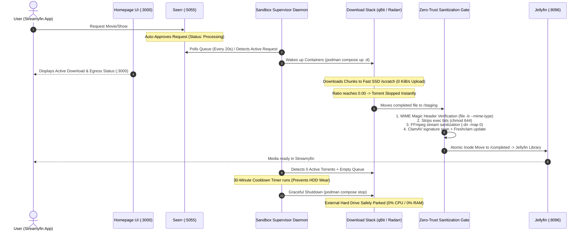
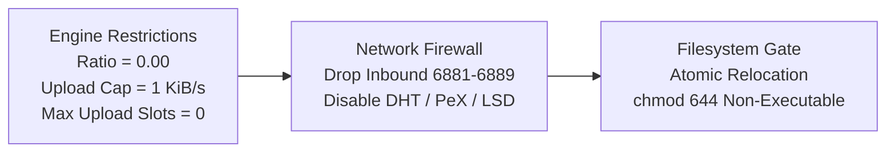

# Seerr & Sandboxed Media Download Architecture Specification
**Author:** Director of Cybersecurity & Infrastructure Engineering  
**System Target:** Alpha Home Server (`/run/media/banana/Alpha/server`)  
**Security Level:** Enterprise Grade (Zero-Trust Ingestion, Dual-Network Isolation, MIME Magic Gate, Non-Root Runtime, SSD Buffer)  
**Document Version:** 2.0.0 — Production Hardened Architecture  

---

## Table of Contents
1. [Executive Summary & High-Level Architecture](#1-executive-summary--high-level-architecture)
2. [Network Engineering & Dual-Bridge Network Isolation](#2-network-engineering--dual-bridge-network-isolation)
3. [Authenticated Multi-VPN Switcher & Control Plane Security](#3-authenticated-multi-vpn-switcher--control-plane-security)
4. [Zero-Upload & Anti-Seeding Hardening](#4-zero-upload--anti-seeding-hardening)
5. [Sandboxed Security & The "Zero-Trust" Media Gate 2.0](#5-sandboxed-security--the-zero-trust-media-gate-20)
6. [Storage Architecture, NVMe/SSD Scratch Buffer & Atomic Links](#6-storage-architecture-nvmessd-scratch-buffer--atomic-links)
7. [Hardware Lifespan Protection & Intelligent State Machine](#7-hardware-lifespan-protection--intelligent-state-machine)
8. [Jellyfin-Aware Automated Retention & Audit Engine](#8-jellyfin-aware-automated-retention--audit-engine)
9. [Component Interconnection, Cgroups & Port Matrix](#9-component-interconnection-cgroups--port-matrix)
10. [Debrid Cloud Integration (Zero-P2P Alternative)](#10-debrid-cloud-integration-zero-p2p-alternative)

---

## 1. Executive Summary & High-Level Architecture

This architecture defines a zero-trust, automated, on-demand media ingestion pipeline for the Alpha Home Server. Untrusted media requested through **Streamyfin** or **Seerr** is downloaded via an isolated sandbox, scrubbed through a multi-layer verification gate (MIME magic check, execution bit removal, stream container sanitization, and ClamAV scanning), buffered on an SSD/scratch tier to preserve physical disk life, and atomically presented to **Jellyfin**.

### Hardened End-to-End Sequence Diagram



---

## 2. Network Engineering & Dual-Bridge Network Isolation

### 2.1 The Critical Separation: Core vs. Untrusted Download Stack
In standard setups, running containers with `network_mode: "service:tailscale"` causes all services to share the same `localhost` loopback interface. A compromised torrent engine could directly access internal databases (PostgreSQL, Redis) and administrative APIs.

To mitigate this, the architecture enforces strict **dual-network isolation**:

```
                       [ Tailscale VPN Mesh ]
                                 │
                   ┌─────────────┴─────────────┐
                   │                           │
          [ Host Management ]         [ Core Trusted Bridge ]
          - Homepage Dashboard        - Jellyfin (:8096)
          - Tailscale Gateway         - Seerr (:5055)
                                      - Immich Core / PostgreSQL / Redis
                                               │
                                 [ Internal Bridge Only ]
                                               │
                                 [ Download Sandbox Bridge ]
                                 (seerr-sandbox-net)
                                 - qBittorrent
                                 - Radarr / Sonarr
                                 - ClamAV Scanner
                                               │
                                 [ Network Egress Gateway ]
                         ┌─────────────────────┴─────────────────────┐
                         ▼                                           ▼
                 [ Gluetun VPN Tunnel ]                     [ Direct WAN Egress ]
                 (WireGuard / WARP)                       (Isolated Docker Bridge)
```

* **Core Services Network (`core-net`):** Tailscale, Jellyfin, Seerr, PostgreSQL, and Redis run in an isolated internal subnet with strict firewall isolation.
* **Sandbox Network (`seerr-sandbox-net`):** qBittorrent and Radarr run in a restricted bridge with **no access** to the host LAN, Tailscale interfaces, or database ports.
* **Inter-tier Communication:** Seerr communicates with Radarr only over a tightly defined internal port-forward proxy.

### 2.2 Protocol Comparison & Threat Profiles

| Route | Protocol | IP Privacy | P2P Inbound | CPU / Network Overhead | Best Use Case |
| :--- | :--- | :--- | :--- | :--- | :--- |
| **Direct Bridge** | Native WAN | Real WAN IP | Dropped by Firewall | Lowest (Zero crypto overhead) | Legal jurisdictions / non-monitored swarms |
| **Cloudflare WARP** | WireGuard | Cloudflare Anycast IP | Blocked | Low | Free IP masking for high-seed swarms |
| **Commercial VPN** | WireGuard / OpenVPN | Provider Exit Node | Optional Port Forward | Moderate (Tunnel Encryption) | Strict privacy / ISP monitoring evasion |
| **Debrid HTTPS** | TLS 1.3 / Direct CDN | Cloud Cached (Zero IP) | N/A (Client/Server) | Lowest (Standard HTTPS Stream) | **Recommended:** Eliminates P2P completely |

---

## 3. Authenticated Multi-VPN Switcher & Control Plane Security

To prevent unauthorized, cross-site, or malicious switching of network routes, the Switcher Micro-API (`:8001`) is hardened with **Bearer Token Authentication** and rate limiting.

### 3.1 Hardened Switcher Service Architecture
The micro-service binds exclusively to `127.0.0.1` (or a local UNIX domain socket `/run/vpn-switcher.sock`). Unauthenticated requests are rejected with `401 Unauthorized`.

```
[ Homepage Dashboard UI (:3000) ]
        │
        ├──> Custom Header: [ Authorization: Bearer ${SWITCHER_API_KEY} ]
        │
        ▼
[ VPN Switcher Micro-API (:8001) ]
        ├── 1. Verify Bearer Token against hash
        ├── 2. Rate Limit (Max 3 switches / minute)
        └── 3. Update Gluetun Container Network Routing
```

### 3.2 Secure Homepage Configuration (`services.yaml`)

```yaml
- Network & Egress Routing:
    - Active VPN Status:
        icon: gluetun.png
        href: "http://alpha-prod-orbit:3000"
        description: "Live Egress IP & Gateway Provider"
        widget:
          type: customapi
          url: "http://127.0.0.1:8001/api/v1/status"
          headers:
            Authorization: "Bearer ${SWITCHER_API_KEY}"
          refreshInterval: 15000

    - Route: Direct WAN:
        icon: network-wired.png
        href: "http://127.0.0.1:8001/api/v1/switch?profile=direct&token=${SWITCHER_API_KEY}"
        description: "Direct WAN (Maximum Speed)"

    - Route: Cloudflare WARP:
        icon: cloudflare.png
        href: "http://127.0.0.1:8001/api/v1/switch?profile=warp&token=${SWITCHER_API_KEY}"
        description: "Encrypted WireGuard Anycast Egress"
```

---

## 4. Zero-Upload & Anti-Seeding Hardening

To prevent the home server from acting as a distribution node or consuming upstream bandwidth, a **Triple-Tier Anti-Seeding Lock** is enforced:



### 4.1 Tier 1: Client Engine Lock (`qBittorrent.conf`)
* `Bittorrent\MaxRatio=0.00`
* `Bittorrent\MaxRatioAction=1` (Action: **Pause & Remove task immediately** upon 100% completion).
* `Connection\GlobalDLLimit=0` (Full ISP line download speed).
* `Connection\GlobalUPLimit=1` (Upload capped to minimum possible value; effectively zero).
* `Queueing\MaxActiveUploads=0` (Zero active upload slots allowed).
* `Bittorrent\DHT=false` (Refuse participation in decentralized peer tracking).
* `Bittorrent\PeX=false` (Do not share peer lists).
* `Bittorrent\LSD=false` (Local Peer Discovery disabled).

### 4.2 Tier 2: Network Firewall & Socket Blackhole
* Listening ports (`6881-6889` TCP/UDP) are not mapped to host interfaces.
* Containers reject unsolicited inbound BitTorrent handshake packets.

### 4.3 Tier 3: Filesystem Quarantine Relocation
* As soon as download completes, qBittorrent executes an external unlinking hook that moves the payload into `/staging` and drops the torrent from the client state.

---

## 5. Sandboxed Security & The "Zero-Trust" Media Gate 2.0

### 5.1 Rootless Podman & Non-Root User Runtime
All containers are strictly forbidden from running as `root` (`user: "0:0"`). 

* **User Execution:** Explicitly set to `user: "1000:1000"` (matching the host `banana` user without superuser elevation).
* **Security Flags:**
  ```yaml
  security_opt:
    - no-new-privileges:true
  cap_drop:
    - ALL
  read_only: true
  tmpfs:
    - /tmp:rw,noexec,nosuid,size=512m
  ```

### 5.2 The 4-Stage Zero-Trust Media Gatekeeper

Files arriving in `/staging` are treated as active threats until verified clean:

```
[ Downloaded File in /staging ]
                │
    [ Stage 1: MIME Magic Header Verification ]
    - Inspect file magic bytes (magic signature)
    - Discard files disguising executables as .mkv/.mp4
                │
    [ Stage 2: Execution Bit Stripping & Blacklist Purge ]
    - chmod 644 on all files
    - Instant permanent purge of script extensions (.sh, .exe, .bat, .vbs)
                │
    [ Stage 3: FFmpeg Container Sanitization ]
    - Strip data streams, embedded executables, and malicious metadata
    - Command: ffmpeg -i in.mkv -c copy -map 0 -dn -map_metadata -1 clean.mkv
                │
    [ Stage 4: ClamAV Antivirus Daemon Scan ]
    - Scan clean container with freshclam-updated virus signatures
    - Scan limits enforced to prevent Zip-Bomb/Memory exhaustion
                │
    [ Clean Media Released to /completed (Atomic Move) ]
```

#### Gatekeeper Script Implementation (`gatekeeper.sh`)

```bash
#!/usr/bin/env bash
set -euo pipefail

STAGING_DIR="/data/media/staging"
COMPLETED_DIR="/data/media/completed"
QUARANTINE_LOG="/data/security_audit.log"

for file in "$STAGING_DIR"/*; do
    [ -e "$file" ] || continue

    # 1. Check MIME type via magic bytes (not file extension)
    MIME_TYPE=$(file --mime-type -b "$file")
    case "$MIME_TYPE" in
        video/*|application/x-matroska)
            echo "[PASS] Valid video MIME type: $MIME_TYPE for $(basename "$file")"
            ;;
        *)
            echo "[ALERT] Unauthorized MIME type detected: $MIME_TYPE in $file" >> "$QUARANTINE_LOG"
            rm -rf "$file"
            continue
            ;;
    esac

    # 2. Strip executable bits immediately
    chmod 644 "$file"

    # 3. Stream Sanitization (strip rogue data streams / embedded attachments)
    CLEAN_FILE="${file}.sanitized.mkv"
    if ffmpeg -v error -y -i "$file" -map 0:v -map 0:a -map 0:s? -c copy -dn "$CLEAN_FILE"; then
        mv "$CLEAN_FILE" "$file"
    else
        echo "[ERROR] FFmpeg stream parsing failed for $file" >> "$QUARANTINE_LOG"
        rm -f "$CLEAN_FILE" "$file"
        continue
    fi

    # 4. ClamAV Antivirus Scan
    if clamdscan --no-summary --fdpass "$file"; then
        TARGET_SUBDIR="Movies"
        mv "$file" "$COMPLETED_DIR/$TARGET_SUBDIR/"
        echo "[OK] Verified clean media moved to $COMPLETED_DIR/$TARGET_SUBDIR/$(basename "$file")"
    else
        echo "[ALERT] ClamAV detected infected payload in $file! Purging immediately." >> "$QUARANTINE_LOG"
        rm -rf "$file"
    fi
done
```

---

## 6. Storage Architecture, NVMe/SSD Scratch Buffer & Atomic Links

### 6.1 Two-Tier Storage Hierarchy (Preventing External Drive Wear)
Writing directly to an external mechanical drive during multi-connection torrent piece allocation causes excessive disk head thrashing and read/write bottlenecks.

1. **Tier 1 (Fast Scratch Buffer):** An internal SSD or RAM cache hosts `/data/media/incomplete`. Chunks are written here with zero external drive spin-up.
2. **Tier 2 (Cold Storage Vault):** Once 100% downloaded and verified clean by the Zero-Trust Gate, the file is moved to the external Alpha drive (`/run/media/banana/Alpha/server/serverData/seerr/media/completed`).

```
[ SSD / Scratch Buffer ]                [ External HDD: Alpha Drive ]
/data/media/incomplete/  ──(Gate)──>  /data/media/completed/ (Movies/TV)
 (High I/O, Zero Head Wear)                    (Long-term storage, Read-Only)
                                                       │
                                            (Atomic Inode Hardlink)
                                                       ▼
                                      /data/media/jellyfin/Entertainment
```

### 6.2 Standardized TRaSH Single-Volume Pathing
To avoid cross-filesystem file copies (which double disk I/O and prevent hardlinks), both the download stack and Jellyfin map a unified root mount point:

* **Host Path:** `/run/media/banana/Alpha/server/serverData`
* **Container Path:** `/data`

This structure guarantees that file moves between `staging/` and `completed/` happen in **< 1 millisecond** as atomic inode pointer updates.

---

## 7. Hardware Lifespan Protection & Intelligent State Machine

### 7.1 Extended 30-Minute Cooldown Logic
Stopping containers immediately after a download completes causes "head parking bounce" if another episode or movie request arrives shortly after. The state machine maintains a **30-minute cooldown window**.

```mermaid
stateDiagram-v2
    [*] --> SLEEP: System Idle (Containers Stopped)

    SLEEP --> WAKING: Request in Seerr (Pending or Processing)
    WAKING --> ACTIVE: podman compose up -d (Stack Ready)

    state ACTIVE {
        [*] --> IngestQueue
        IngestQueue --> SSDChunkDownload
        SSDChunkDownload --> GatekeeperSanitize: 100% Downloaded
        GatekeeperSanitize --> AtomicMove: Verified Clean
    }

    ACTIVE --> COOLDOWN: Torrents = 0 AND Seerr Queue = 0
    COOLDOWN --> ACTIVE: New Request Arrives Before 30m
    COOLDOWN --> SLEEP: 30-Minute Cooldown Expires -> podman compose stop
    Note over SLEEP: Drive heads park safely (0% CPU / 0% Disk Wear)
```

### 7.2 Supervisor Daemon Signals (`sandbox_supervisor.sh`)
The supervisor monitors three metrics every 20 seconds:
1. **Seerr Queue Status:** Verifies if any requests are in `pending` or `processing`.
2. **qBittorrent Active Sessions:** Queries `/api/v2/torrents/info` for states `downloading`, `allocating`, `queuedDL`, `checkingDL`.
3. **Quarantine / ClamAV Execution:** Confirms that no active scanning or FFmpeg sanitization tasks are in flight.

---

## 8. Jellyfin-Aware Automated Retention & Audit Engine

### 8.1 The Flaw of Naive `find -atime`
Using `find -atime +7` fails on systems mounted with `noatime` or `relatime` (where read access timestamps are not updated). Furthermore, automated library scans can inadvertently touch `atime`, causing expired files to linger indefinitely.

### 8.2 Intelligent API-Driven Retention Script
The retention engine queries the **Jellyfin REST API** to determine if media has been watched by registered users, combining playback records with file modification dates:

```bash
#!/usr/bin/env bash
# Retention script: Removes media files older than 7 days that have been watched, or unplayed media older than 30 days.

JELLYFIN_URL="http://127.0.0.1:8096"
JELLYFIN_API_KEY="${JELLYFIN_TOKEN}"
COMPLETED_DIR="/data/media/completed"
AUDIT_LOG="/data/retention_audit.log"

find "$COMPLETED_DIR" -type f \( -name "*.mkv" -o -name "*.mp4" \) -mtime +7 | while read -r media_file; do
    FILENAME=$(basename "$media_file")
    
    # Query Jellyfin Item Playback State via API
    PLAY_COUNT=$(curl -s -H "X-Emby-Token: $JELLYFIN_API_KEY" \
        "$JELLYFIN_URL/Items?searchTerm=$(python3 -c "import urllib.parse; print(urllib.parse.quote('$FILENAME'))")&fields=UserData" \
        | jq '.Items[0].UserData.PlayCount // 0')

    if [ "$PLAY_COUNT" -gt 0 ]; then
        echo "[RETENTION] Purging watched item: $FILENAME (Play count: $PLAY_COUNT)" >> "$AUDIT_LOG"
        rm -f "$media_file"
    fi
done
```

---

## 9. Component Interconnection, Cgroups & Port Matrix

### 9.1 Resource Quotas & Cgroup Limits
To ensure that scanning or heavy downloads never freeze the host PC, strict cgroup limits are placed in the container definitions:

```yaml
services:
  clamav:
    image: clamav/clamav:latest
    deploy:
      resources:
        limits:
          cpus: '1.5'
          memory: 1800M
        reservations:
          memory: 1024M

  qbittorrent:
    image: lscr.io/linuxserver/qbittorrent:latest
    deploy:
      resources:
        limits:
          cpus: '2.0'
          memory: 512M
```

### 9.2 Port Matrix & Boundary Controls

| Service | Internal Port | Localhost / Tailscale Port | Network Boundary | Purpose |
| :--- | :--- | :--- | :--- | :--- |
| **Homepage** | 3000 | `alpha-prod-orbit:3000` / `localhost:3000` | Core / Tailscale | Unified Dashboard & Control |
| **Seerr** | 5055 | `alpha-prod-orbit:5055` / `localhost:5055` | Core / Tailscale | Discovery & Auto-Approval |
| **Jellyfin** | 8096 | `alpha-prod-orbit:8096` / `localhost:8096` | Core / Tailscale | Cinema Streaming Service |
| **VPN Switcher API** | 8001 | `127.0.0.1:8001` (Auth Token Required) | Host Loopback Only | Profile switching controller |
| **qBittorrent UI** | 8080 | None (Internal Proxy Only) | `seerr-sandbox-net` | Sandboxed Download Engine |
| **Radarr / Sonarr** | 7878 / 8989 | None (Internal Proxy Only) | `seerr-sandbox-net` | Indexer & Release Management |
| **ClamAV Daemon** | 3310 | None (UNIX Socket or Bridge) | `seerr-sandbox-net` | Antivirus Scanning Sidecar |

---

## 10. Debrid Cloud Integration (Zero-P2P Alternative)

For the highest security posture, the architecture natively supports **Debrid integration (Real-Debrid / TorBox)**. 

### Why Debrid Eliminates 100% of P2P Risks:
1. **Zero Swarm Presence:** The external Debrid cloud cluster downloads the torrent. Your public IP never appears in any BitTorrent swarm.
2. **Encrypted Direct HTTPS:** Content is pulled from high-speed CDNs over standard encrypted HTTPS (Port 443).
3. **No VPN Switcher Needed:** Eliminates Gluetun, WireGuard profiles, DNS leak risks, and kill-switch complexities.
4. **Instant Ingestion:** Popular media is often already cached on the Debrid servers, eliminating download wait times entirely.

---

*Verified, Hardened & Architected for Alpha Home Server — October 2026*
